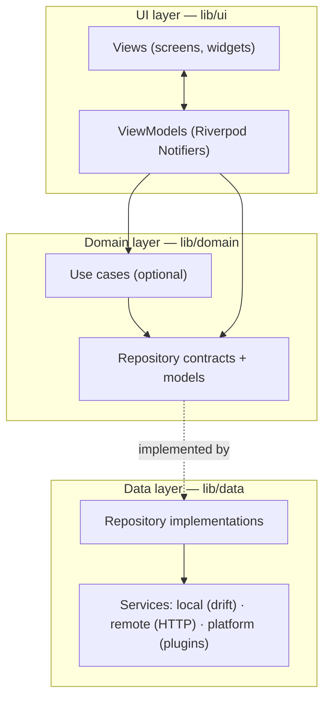

# Flutter Clean + MVVM Architecture Template 🚀

A production-ready starting point for Flutter apps, built on **Clean Architecture + MVVM** as recommended by Flutter's official [app architecture guide](https://docs.flutter.dev/app-architecture): Riverpod ViewModels, a domain layer with use cases, repositories over services, offline-first data, a full design system, and the tooling (tests, Mason bricks, CI, AI-agent rules) to keep it that way.

It ships with a complete **example app**, a detailed to-do app, so every layer and pattern can be seen working end to end. When you start a real app, the `fresh-start` skill removes the example and keeps the foundation.

> Looking for the earlier Cubit (flutter_bloc), feature-first version? It's kept at the git tag [`cubit-template`](../../tree/cubit-template).

## Table of Contents 📌

- [What's Inside](#whats-inside)
- [The Example App](#the-example-app)
- [Architecture](#architecture)
- [Getting Started](#getting-started)
- [Project Structure](#project-structure)
- [Key Patterns](#key-patterns)
- [Design System](#design-system)
- [Starting a New App](#starting-a-new-app)
- [Scaffolding with Mason](#scaffolding-with-mason)
- [Testing](#testing)
- [AI Agent Support](#ai-agent-support)
- [CI/CD & Release](#cicd--release)
- [Documentation](#documentation)

## What's Inside

| Area | What you get |
| --- | --- |
| **Architecture** | UI (Views + Riverpod Notifiers) → optional use cases → repositories → services, with sealed `DataState` results everywhere |
| **State** | `hooks_riverpod` 3, `BaseNotifier`/`BaseState`, one-shot `StateMessage`s, Views that own toasts and navigation |
| **Data** | dio `HttpClient` with token refresh, `ApiExecutor`, drift database (mobile + web), offline-first repositories, connectivity |
| **Errors** | `ErrorHandler` + translators + recorders, action paths per user flow, an on-device error log screen |
| **Text** | One message catalog for every user-facing string, versioned |
| **Design system** | Light/dark tokens (colour, type, spacing, radius, motion), ~30 base widgets, adaptive bottom bar / sidebar |
| **Platforms & flavors** | Android, iOS, Web × development, staging, production |
| **Tooling** | get_it + injectable, auto_route, Mason bricks, mocktail + patrol tests, GitHub Actions + fastlane releases, `leancode_lint` |
| **Modern Dart** | Dart 3.14: primary constructors, dot shorthands, null-aware elements, switch expressions |

## The Example App

A detailed to-do app against the public [DummyJSON](https://dummyjson.com) API (demo login `emilys` / `emilyspass`):

| Screen | Shows |
| --- | --- |
| Splash | Startup routing (onboarding → login → home) |
| Onboarding | A 3-page intro, remembered once seen |
| Login | Form validation in the ViewModel, use case chaining, session storage |
| Tasks | Stats with a progress ring, search, filters, categories, sort, grouped sections, pull-to-refresh sync |
| Task detail | Live updates from the database, subtask checklist, complete / delete |
| Task editor | Priority, category, due date + time, subtasks, discard protection |
| Inbox | Local notifications (due/overdue reminders, activity), unread badge |
| Profile / Edit profile | Remote user refresh, photo picking, validation |
| Settings / Error log | Theme mode, reminders, clear completed, version, error log viewer |

## Architecture



- **Views** render state and forward actions; they show toasts and navigate.
- **ViewModels** hold screen state, validate, and call repositories/use cases. They never touch `BuildContext`.
- **Use cases** combine repositories for one flow (e.g. login → sync → welcome notification).
- **Repositories** are the single source of truth for a kind of data and map DTOs to domain models.
- **Services** do one kind of I/O and turn every exception into a `FailureState`.

Read [docs/architecture/architecture.md](docs/architecture/architecture.md) for the full picture and the data flow.

## Getting Started

**Prerequisites:** Flutter 3.50+ (Dart 3.14+), Xcode / Android Studio for mobile, Chrome for web.

```bash
git clone <this repo>
cd flutter-clean-architectures
cp .env.example .env              # base URLs per flavor (defaults to the demo API)
flutter pub get
dart run build_runner build       # routes, DI, database
flutter run --flavor development -t lib/main_dev.dart
# Web: flutter run -d chrome -t lib/main_dev.dart
```

| Flavor | Entry point |
| --- | --- |
| development | `lib/main_dev.dart` |
| staging | `lib/main_stg.dart` |
| production | `lib/main.dart` |

## Project Structure

```text
lib/
├── config/            # AppConfig per flavor, DI setup
├── core/              # app-agnostic: clients, DataState, errors, messages, types, utils
├── data/              # models (DTOs, mappers), repositories, services (local/remote/platform)
├── domain/            # models, repository contracts, use cases
├── routing/           # AppRouter + guards
└── ui/
    ├── core/          # providers (base, session, settings...), themes, base widgets, utils
    ├── features/      # <feature>/{models, providers, widgets, views/<screen>/widgets}
    ├── startup/       # app bootstrap + startup error screen
    └── application.dart
```

## Key Patterns

**A ViewModel** runs each user flow in `runFlow`, reports failures with `trackFailure`, and returns a result instead of navigating:

```dart
Future<bool> login({required String username, required String password}) =>
    runFlow('auth.login', () async {
      state = const LoginState(status: .loading);
      final result = await GetIt.I<LoginUseCase>()((username: username, password: password));
      if (result is SuccessState) {
        state = const LoginState(status: .loaded, message: SuccessMessage(AuthMessages.loggedIn));
        return true;
      }
      state = LoginState(status: .error, message: trackFailure(result));
      return false;
    });
```

**A View** listens for messages and navigates on the result:

```dart
ref.listenMessages(loginProvider, context);
// ...
if (await notifier.login(username: u, password: p) && context.mounted) {
  await context.router.replaceAll([const HomeShellRoute()]);
}
```

**A service** wraps every call so exceptions become recorded, translated failures with an action label:

```dart
FutureList<TodoResponse> todos() => ApiExecutor.call(
  () => _http.get<dynamic>(ApiEndpoints.todos),
  action: 'todo.api.todos',
  fromJson: TodoResponse.fromJson,
  dataKey: 'todos',
);
```

More: [Error Handling](docs/core/error_handling.md), [Networking](docs/core/networking.md), [Local Database](docs/core/local_database.md), [Routing](docs/core/routing.md), [App Messages](docs/core/app_messages.md).

## Design System

A calm, modern look with one vivid **Aurora** gradient (violet → orchid → pink) for the primary action, progress and selection; first-class light and dark themes; Plus Jakarta Sans headings and Inter body text. Widgets read tokens (`context.colors`, `context.text`, `AppSpacing`, `AppRadius`, `AppMotion`) and never hardcode a colour or text style. See [docs/design/design_system.md](docs/design/design_system.md).

## Starting a New App

Ask your AI agent to run the **`fresh-start`** skill (e.g. "start a new app from this template"). It asks, part by part, what to **keep**, **remove** or **replace**: each example feature module, auth, splash, the tab shell, unused base widgets, database tables, the design tokens, the demo backend, and the app name, package name and bundle IDs. Then it applies the plan on a new branch, fixes every reference, regenerates code, and checks that analyze and tests pass.

## Scaffolding with Mason

```bash
dart pub global activate mason_cli && mason get
# edit config.json (feature, notifier, view, model/response/request), then:
mason make riverpod_feature -c config.json   # model + DTOs + repository + services + Notifier + screen
mason make riverpod_view -c config.json      # Notifier + screen in an existing feature
mason make domain_data_model -c config.json  # model + DTOs
```

See the `scaffolding` skill for the follow-up wiring (routes, messages, codegen).

## Testing

```bash
flutter analyze                         # must be clean
flutter test                            # unit + widget tests
flutter test --tags regression          # issue regression tests
patrol test --target patrol_test/todo_flow_test.dart
```

Unit tests cover data states, the error handler, `ApiExecutor`, domain logic, repository sync, use cases and ViewModels (with a `ProviderContainer` and mocks in get_it); widget tests use `patrol_finders`. See [docs/testing/testing.md](docs/testing/testing.md).

## AI Agent Support

The rules agents follow live in [`CLAUDE.md`](CLAUDE.md) and [`.agents/AGENTS.md`](.agents/AGENTS.md) (kept in sync), with skills in `.claude/skills/` and `.agents/skills/`:

| Skill | Does |
| --- | --- |
| `codegen` | Runs `build_runner` |
| `scaffolding` | Generates features, screens and models with Mason |
| `api-integration` | Adds an endpoint through service → repository → ViewModel |
| `testing` | Runs the unit, widget, regression and Patrol suites |
| `fresh-start` | Interactively strips the example app for a new project |

## CI/CD & Release

Builds reach testers through [Firebase App Distribution](https://firebase.google.com/docs/app-distribution) (Android) and TestFlight (iOS), from GitHub Actions or locally with fastlane. Nothing is distributed on push: a release is always started on purpose.

### GitHub Actions

- **Composite actions** (`.github/actions/`): `setup-flutter` (Java 21 + the pinned Flutter, `pub get`), `create-files` (`.env` from secrets, plus Android signing files and `ios/ExportOptions.plist` when their secrets are set) and `flutter-test` (`flutter analyze` + `flutter test`).
- **Workflows** (`.github/workflows/`), manual-only (`workflow_dispatch`) with `release_notes`, `skip_tests` and `platform` (`android`/`ios`/`all`) inputs:
  - `staging_app_distribution.yml`: builds the `staging` flavor.
  - `production_app_distribution.yml`: builds the `production` flavor; only runs from `master`.
- Keep `flutter-version` in `.github/actions/setup-flutter/action.yml` in sync with your local `flutter --version`.
- Release builds are signed with `android/key.properties` when it exists, otherwise with the debug key (fine for internal testers, not for a store).

### Fastlane

1. `bundle config set --local path vendor/bundle && bundle install`
2. Copy `fastlane/.env.example` to `fastlane/.env` and put the key files in `fastlane/keys/` (both gitignored).
3. `bundle exec fastlane android staging` or `bundle exec fastlane ios production notes:"- Fixed ..."` (options: `notes:`, `allow_dirty:true`, `test:true`, `skip_waiting:true`).

### Required Secrets

| Secret | Purpose |
| --- | --- |
| `BASE_PRODUCTION_URL` / `BASE_STAGING_URL` / `BASE_DEVELOPMENT_URL` | API base URLs written into `.env` |
| `FIREBASE_APP_ID_STAGING` / `FIREBASE_APP_ID_PRODUCTION` | Firebase App IDs of the Android apps |
| `CREDENTIAL_FILE_CONTENT` | Firebase service account JSON with App Distribution access |
| `ANDROID_KEYSTORE_FILE` / `ANDROID_KEY_PROPERTIES_FILE` | *(Optional)* Base64 upload keystore and `key.properties` |
| `APPLE_TEAM_ID` | *(iOS)* Apple Developer Team ID |
| `APPLE_IOS_STAGING_BUNDLE_ID` / `APPLE_IOS_PRODUCTION_BUNDLE_ID` | *(iOS)* Bundle ID per flavor |
| `APPLE_STAGING_PROVISIONING_PROFILE_NAME` / `APPLE_PRODUCTION_PROVISIONING_PROFILE_NAME` | *(iOS)* Provisioning profile name per flavor |
| `APPLE_STAGING_PROVISIONING_PROFILE_BASE64` / `APPLE_PRODUCTION_PROVISIONING_PROFILE_BASE64` | *(iOS)* Base64 provisioning profile per flavor |
| `APPLE_CERTIFICATE_BASE64` / `APPLE_CERTIFICATE_PASSWORD` | *(iOS)* Base64 distribution `.p12` and its password |
| `APP_STORE_CONNECT_API_KEY_ID` / `APP_STORE_CONNECT_ISSUER_ID` / `APP_STORE_CONNECT_API_PRIVATE_KEY` | *(iOS)* App Store Connect API key for TestFlight |

## Documentation

| Topic | Doc |
| --- | --- |
| Architecture, layers, data flow, docs map | [architecture.md](docs/architecture/architecture.md) |
| Startup sequence | [app_startup.md](docs/architecture/app_startup.md) |
| SDK, flavors, lints, codegen, app icon and splash, web | [development.md](docs/architecture/development.md) |
| Design system | [design_system.md](docs/design/design_system.md) |
| Errors, messages, routing, networking, database | [docs/core/](docs/core/) |
| Example features | [docs/features/](docs/features/) |
| Testing | [testing.md](docs/testing/testing.md) |
| SOLID principles | [solid_principles.md](docs/guides/solid_principles.md) |
| Flutter tips | [flutter_tips.md](docs/guides/flutter_tips.md) |
| Flutter command cheat sheet | [flutter_commands_cheat_sheet.md](docs/guides/flutter_commands_cheat_sheet.md) |
| Git command cheat sheet | [git_commands_cheat_sheet.md](docs/guides/git_commands_cheat_sheet.md) |
| Flutter configuration guidelines | [flutter_configuration_guidelines.md](docs/guides/flutter_configuration_guidelines.md) |
