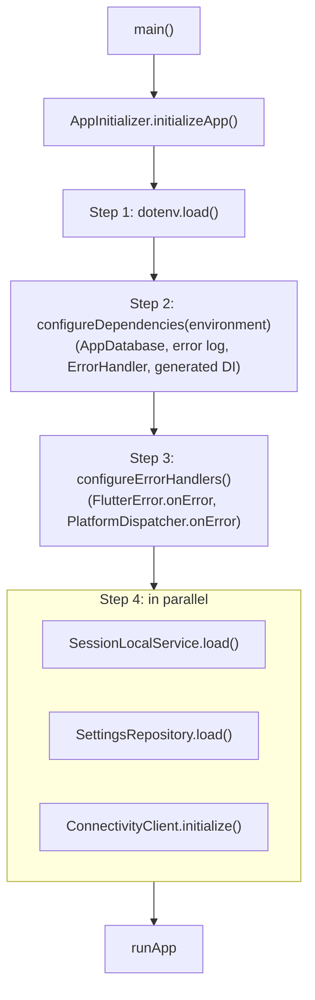

# App Startup

Files: `lib/main*.dart`, `lib/ui/startup/`, `lib/core/app_initializer.dart`, `lib/ui/application.dart`, `lib/ui/features/startup/`.

## Entry Points

Each flavor's `main` calls `runCleanArchitectureApp(environment: Flavor.x)`, which:

1. Calls `WidgetsFlutterBinding.ensureInitialized()` and `usePathUrlStrategy()` (web URLs without `#`).
2. Awaits `AppInitializer.initializeApp(environment:)` (returns `true`/`false`, never throws).
3. On success: `runApp(ProviderScope(child: CleanArchitectureApp()))`. On failure: `StartupErrorApp`, a minimal screen with **Retry** that runs the whole sequence again.

## AppInitializer

Steps 1–3 run once, even when **Retry** calls `initializeApp()` again. Step 4 loads what the router and the first screen read synchronously: the session (guards), settings (theme, onboarding flag) and connectivity (the offline banner).

## Root Widget

`CleanArchitectureApp` builds `MaterialApp.router` with the `AppRouter`, the light/dark themes and the `themeMode` from `appSettingsProvider`. It also:

- updates `screenTypeProvider` after `didChangeMetrics`;
- listens to `sessionProvider`: when the session expires (a token refresh failed), it shows the message and replaces the stack with the login screen.

## Splash

`SplashScreen` (`/`) asks `SplashNotifier.resolve()` for the first destination (after a short minimum so it doesn't flash): **onboarding** if `AppSettings.onboardingSeen` is false, else **home** when a session exists, else **login**. The screen navigates; the notifier only decides.
