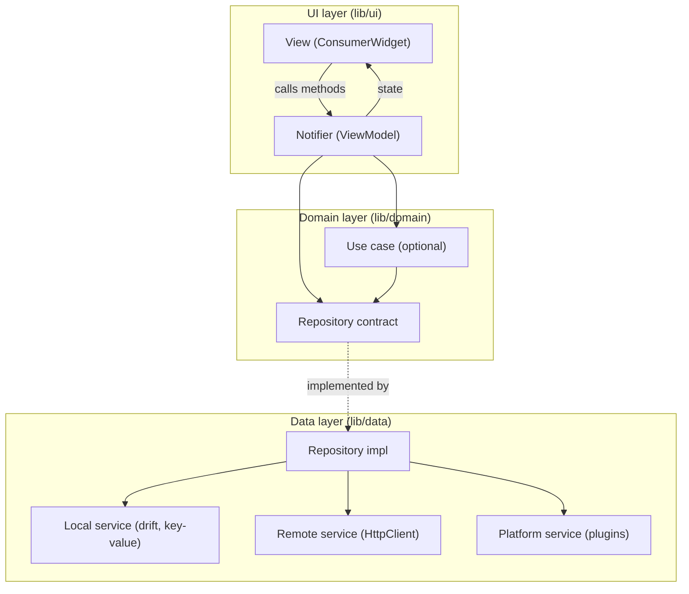
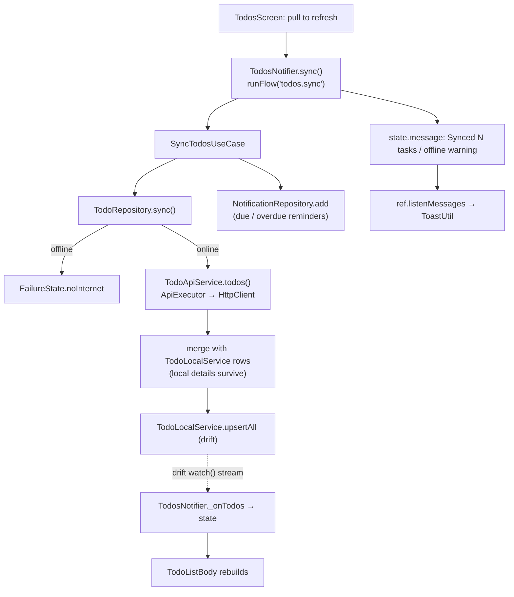

# Architecture

This template uses **Clean Architecture + MVVM**, following Flutter's official [app architecture guide](https://docs.flutter.dev/app-architecture). Business logic never lives in widgets, every layer depends only on the one below it through abstractions, and each piece can be tested on its own.

- **UI layer** (`lib/ui/`): Views (screens and widgets) and ViewModels (Riverpod `Notifier`s), grouped by feature.
- **Domain layer** (`lib/domain/`): entities, repository contracts and optional use cases. Pure Dart.
- **Data layer** (`lib/data/`): repository implementations and services, grouped by type.
- **Core** (`lib/core/`): app-agnostic building blocks every layer uses (data states, error handling, clients, message catalog, utilities).

The example app is a detailed to-do app (onboarding, login, tasks with priorities/categories/due dates/subtasks, inbox, profile, settings). The `fresh-start` skill removes it when you start a real app.

## Table of Contents

- [Project Structure](#project-structure)
- [Layers](#layers)
- [ViewModels with Riverpod](#viewmodels-with-riverpod)
- [Dependency Injection](#dependency-injection)
- [Data States](#data-states)
- [Data Flow](#data-flow)
- [Responsiveness](#responsiveness)
- [Docs Map](#docs-map)

## Project Structure

```text
lib/
├── config/
│   ├── app_config.dart          # AppConfig per flavor (title, base URL from .env)
│   └── injector/                # get_it + injectable setup
├── core/
│   ├── clients/
│   │   ├── database/            # AppDatabase (drift) + tables/
│   │   └── remote/              # ConnectivityClient, http/ (HttpClient, HttpAuthInterceptor, TokenStore)
│   ├── constants/               # ApiEndpoints, HttpKeys, StorageKeys
│   ├── data/                    # states/ (DataState), operations/ (ApiExecutor, RepositoryFetcher), DomainConvertible
│   ├── errors/                  # ErrorHandler, ErrorFlow, translators/, recorders/
│   ├── messages/                # app_messages.dart: every user-facing string
│   ├── types/                   # FutureData, FutureList, FutureVoid, StreamData, JsonMap
│   ├── utils/                   # UseCase0/1, Debouncer, extensions/
│   └── app_initializer.dart
├── data/
│   ├── models/
│   │   ├── requests/            # request DTOs (toJson)
│   │   ├── responses/           # response DTOs (fromJson + toDomain)
│   │   ├── local/               # how domain models are stored as JSON
│   │   └── mappers/             # drift row ↔ domain model
│   ├── repositories/            # Auth, User, Todo, Notification, Settings, ErrorLog, AppInfo
│   └── services/
│       ├── local/               # drift and key-value services
│       ├── remote/              # HTTP services (one per API area)
│       └── platform/            # plugins: image picker, package info
├── domain/
│   ├── models/                  # User, Session, Todo, Subtask, TodoQuery, TodoStats, AppNotification, AppSettings, ...
│   ├── repositories/            # abstract contracts
│   └── use_cases/               # Login, Logout, SyncTodos, SaveTodo, SetTodoCompleted
├── routing/
│   ├── routes.dart              # AppRouter (auto_route)
│   └── guards/                  # AuthenticatedGuard, UnauthenticatedGuard
└── ui/
    ├── core/
    │   ├── providers/           # base/ (BaseNotifier, BaseState, ErrorTracking), session/, settings/, connectivity/, screen_type/
    │   ├── themes/              # design tokens (see design_system.md)
    │   ├── ui/base/             # design-system widgets
    │   └── utils/               # ToastUtil, ref extensions, validators, date formats, frame callback
    ├── features/
    │   ├── startup/             # splash: decides onboarding / login / home
    │   ├── onboarding/          # 3-page intro
    │   ├── auth/                # login
    │   ├── home/                # tab shell: bottom bar / sidebar
    │   ├── todos/               # list, detail, editor
    │   ├── notifications/       # inbox
    │   ├── profile/             # profile, edit profile
    │   └── settings/            # settings, error log
    ├── startup/                 # runCleanArchitectureApp, StartupErrorApp
    └── application.dart         # CleanArchitectureApp (MaterialApp.router)
```

Each feature follows:

```text
lib/ui/features/<feature>/
    ├── models/       # UI-only models and presentation extensions (labels, icons, colours)
    ├── providers/    # Notifiers (ViewModels) + states
    ├── widgets/      # widgets shared by this feature's screens
    └── views/
        └── <screen>/
            ├── <screen>_screen.dart
            └── widgets/  # widgets only this screen uses
```

## Layers



| Layer piece | Does | Never does |
| --- | --- | --- |
| **View** | Renders state, forwards user actions, shows toasts/dialogs, navigates | Business logic, validation, filtering, calling repositories |
| **Notifier** | Holds screen state, validates input, calls repositories/use cases, sets `message`, returns results | Touch `BuildContext`, show toasts, navigate, call services |
| **Use case** | Combines repositories for one flow (`LoginUseCase`: log in → sync → welcome notification) | Exist for single-repository calls |
| **Repository** | The only thing Notifiers and use cases talk to; maps DTOs to domain models; offline-first decisions | Return DTOs |
| **Service** | One kind of I/O, every call wrapped in `ErrorHandler.execute(action:)` / `ApiExecutor` | Know about domain models or other services |

## ViewModels with Riverpod

- Every Notifier extends `BaseNotifier` / `BaseAsyncNotifier` / `BaseStreamNotifier`; every state extends `BaseState` (`StateStatus` + `StateMessage`).
- `copyWith` never keeps the old `message`, so each message is shown once.
- Dependencies come from get_it in `build()` (`GetIt.I<TodoRepository>()`), so tests swap them by registering mocks.
- Each user flow runs in `runFlow('<feature>.<flow>', ...)`; failures are surfaced with `trackFailure` / `trackError`, which also mark them in the error log. See [Error Handling](../core/error_handling.md).
- **Keep-alive** providers hold app-wide state: `sessionProvider`, `appSettingsProvider`, `connectivityProvider`, `screenTypeProvider`, `todosProvider` (the list survives tab switches and keeps syncing). Screen state is `.autoDispose`, and `.family` when keyed by an id (`todoDetailProvider(id)`, `todoEditorProvider(id)`).
- Views show messages with `ref.listenMessages(provider, context)` and react to results:

```dart
final saved = await ref.read(todoEditorProvider(id).notifier).save();
if (saved != null && context.mounted) {
  await context.router.replace(TodoDetailRoute(todoId: saved));
}
```

## Dependency Injection

- `get_it` + `injectable`: annotate with `@injectable`, `@lazySingleton` or `@LazySingleton(as: Contract)` and run `dart run build_runner build`.
- `configureDependencies` (`lib/config/injector/injector.dart`) registers `AppDatabase`, `AppErrorRecorder` and `ErrorHandler` by hand first (everything depends on them), then the generated initializer with the flavor's environment, so only that flavor's `AppConfig` is registered.
- `SessionLocalService` is registered twice through a module: as itself and as the HTTP client's `TokenStore`, so `core/` never imports `data/`.

## Data States

`DataState<T>` (`lib/core/data/states/`) is sealed: `SuccessState`, `FailureState`, `LoadingState`. Repositories return `FutureData<T>`, `FutureList<T>`, `FutureVoid` or `StreamData<T>`. `FutureVoid` methods return `const SuccessState.nil()`.

A `FailureState` carries a user-facing `message` (from the catalog or the server), a raw `error` for the log, an `origin` (`local`/`remote`), and an **action path** (`['todos.sync', 'todo.api.todos']`) that `ErrorHandler` and `runFlow` build as it travels up, so the error log shows which step of which flow failed.

## Data Flow

Pull-to-refresh on the task list, from gesture to screen:



The local table is the source of truth: screens watch drift streams, so a change from anywhere (editor, detail, sync) shows up everywhere without manual refreshes.

## Responsiveness

`ScreenTypeNotifier` tracks the breakpoint (phone < 600, tablet < 840, desktop). The root widget listens for `didChangeMetrics` and updates it after the frame. The shell uses a floating bottom bar on phones and tablets and a sidebar on wide screens; `ScreenScrollView` caps content at a readable width. See the [Design System](../design/design_system.md#layout-and-navigation).

## Docs Map

| Area | Doc |
| --- | --- |
| Startup | [App Startup](app_startup.md) |
| SDK, lints, flavors, codegen, app icon and splash, releases | [Development](development.md) |
| Look and feel | [Design System](../design/design_system.md) |
| Routing and guards | [Routing](../core/routing.md) |
| HTTP, auth tokens, connectivity | [Networking](../core/networking.md) |
| Errors and the error log | [Error Handling](../core/error_handling.md) |
| Strings | [App Messages](../core/app_messages.md) |
| Database | [Local Database](../core/local_database.md) |
| Example features | [Auth & Onboarding](../features/auth.md), [Tasks](../features/todos.md), [Inbox](../features/notifications.md), [Profile](../features/profile.md), [Settings](../features/settings.md) |
| Tests | [Testing](../testing/testing.md) |
| General guides | [SOLID](../guides/solid_principles.md), [Flutter Tips](../guides/flutter_tips.md), [Flutter Commands](../guides/flutter_commands_cheat_sheet.md), [Configuration](../guides/flutter_configuration_guidelines.md), [Git](../guides/git_commands_cheat_sheet.md) |
