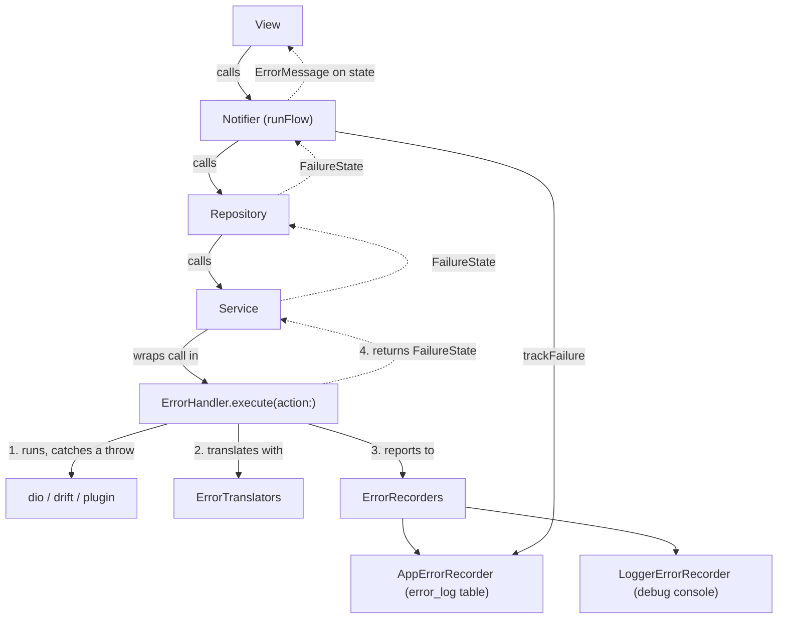

# Error Handling

Files: `lib/core/errors/`, `lib/ui/core/providers/base/error_tracking.dart`.

## Overview

An exception is caught at the bottom (in a service), translated into a `FailureState` with a user message, recorded, and travels back up. A Notifier then decides whether to show it.



## ErrorHandler

`ErrorHandler` (`error_handler.dart`, registered by `ErrorHandlerProvider.register` in `configureDependencies`):

- `execute<T>(callback, action:)`: runs the callback; a throw becomes a translated `FailureState<T>` with an error id and stack trace, recorded and returned. A returned `FailureState` gets `action` added to its action path. The label names the exact operation: `'todo.local.upsert'`, `'auth.api.login'`.
- `executeStream<T>(stream, action:)`: wraps each value in `SuccessState`; an error event becomes a recorded `FailureState` event instead of killing the stream (used for drift `watch()` streams).
- `executeSafe` / `executeSafeReturn(onError:)`: record but don't propagate, for best-effort work.
- `configureErrorHandlers()`: hooks every recorder into uncaught errors.

`ApiExecutor.call` / `voidCall` (`lib/core/data/operations/api_executor.dart`) wrap HTTP requests in `execute` and parse the body (`fromJson`, optional `dataKey`), so remote services stay one-liners.

`ErrorFlow` (`error_flow.dart`) carries the current user flow (`action`) and Notifier (`source`) in a `Zone`, so an error recorded deep in the data layer knows which flow it broke without every method taking a parameter.

## Translators

Tried in order; the first match wins. Anything unmatched becomes a `FailureState` with `CommonMessages.genericError`.

| Translator | Turns | Into |
| --- | --- | --- |
| `DioErrorTranslator` | `DioException` | 400/422 → the server's `message` or `badRequest`; 401/403 → `unauthorized`; 404 → `notFound`; timeouts/connection → `network`; else `serverError`. The logged error keeps host + path only. |
| `DriftErrorTranslator` | `DriftWrappedException` | `storageError` |

Add one per error source your app has (Firebase, a payment SDK...): implement `ErrorTranslator<E>` and list it in `configureDependencies`.

## Recorders

- `AppErrorRecorder`: writes to the `error_log` drift table (time, action path, source Notifier, message, error, whether it was shown), capped at 500 entries, with URL queries stripped. `trackFailure` marks an already-recorded failure as shown instead of adding a row. Visible in **Settings → Error log**, with **Copy** for bug reports.
- `LoggerErrorRecorder`: prints in debug builds only.
- Add a crash-reporting recorder (Crashlytics, Sentry) by implementing `ErrorRecorder` and listing it in `configureDependencies`.

## In Notifiers

`ErrorTracking` (mixed into the base Notifiers) gives `runFlow`, `trackFailure` and `trackError`:

```dart
Future<void> delete(Todo todo) => runFlow('todos.delete', () async {
  final result = await _repository.delete(todo.id);
  if (!ref.mounted) {
    return;
  }
  state = state.copyWith(
    message: result is SuccessState
        ? const SuccessMessage(TodoMessages.deleted)
        : trackFailure(result),
  );
});
```

One label per user flow (`'<feature>.<flow>'`); data-layer labels are different, so the log's action path (`todos.sync > todo.api.todos`) shows which step failed. `trackFailure`/`trackError` assert they're called inside `runFlow` (or with an explicit `action:`).
