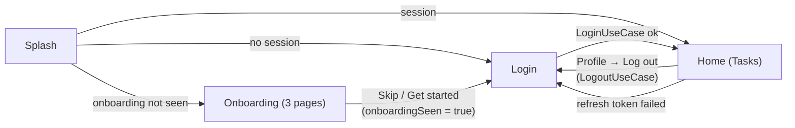

# Auth & Onboarding (example)

Files: `lib/ui/features/{startup,onboarding,auth}/`, `lib/ui/core/providers/session/`, `lib/domain/use_cases/{login,logout}_use_case.dart`, `lib/data/repositories/auth_repository_impl.dart`, `lib/data/services/local/session_local_service.dart`, `lib/data/services/remote/auth_api_service.dart`.

## Flow

## Onboarding

`OnboardingScreen` shows the `OnboardingPage` enum (icon, title, body) in a `PageView` with `PageDots`. **Skip** and **Get started** call `appSettingsProvider.completeOnboarding()` and go to login. The page index is pure presentation, so it lives in a hook (`useState`), not a Notifier.

## Login

- `LoginForm` keeps the text in hook controllers and calls `LoginNotifier.login(username:, password:)`.
- The Notifier validates (`Validators.required`), sets field errors on state, then runs `LoginUseCase`: `AuthRepository.login` → `SyncTodosUseCase` → welcome notification. A failed sync doesn't fail the login.
- It returns `true` on success; the form replaces the stack with `HomeShellRoute`.
- **Demo account:** the demo backend's public user (`emilys` / `emilyspass`) is filled in by **Use demo account**.

## Session

- `SessionLocalService` stores `Session` (tokens + user, with a picked photo as base64) in the `key_value` table and keeps it in memory: `AuthRepository.isLoggedIn` is synchronous for the route guards.
- It also implements the HTTP client's `TokenStore` (token refresh, expiry). See [Networking](../core/networking.md#authentication).
- `sessionProvider` (keep-alive) exposes the signed-in `User` to the UI and reports expiry.

## Logout

`LogoutUseCase` clears the tasks, the inbox and the session (in parallel), so the next account starts clean. The profile's **Log out** confirms first, then resets the stack to login.
